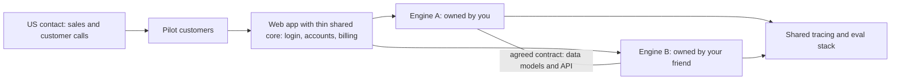

# AI Portfolio Product: Idea Menu and Plan

Context: you're mid-level, can put in 20+ hours/week, haven't settled on a role, and have a US contact who may sell. Your friend is a senior engineer with the same goal.

## Bottom line

- **Is an AI SaaS a good idea?** Yes, as long as it's narrow: one workflow for one US industry. Building it exercises exactly what AI-engineer interviews test, and real customers are the strongest proof you can show. Generic AI tools are a dead end (see "Skip these" below).
- **Target role: AI Engineer**, meaning someone who builds reliable products on top of LLMs. In 390 job posts from July 2026, the top asks were LLMs (63%), Python (59%), evals (56%) and agents (50%), while PyTorch appeared in only 33%. Only about 1% of posts are junior, so your experience fits. The typical switch from software engineering is 3-5 months of focused building ([Dexity](https://dexity.com/intel/ai-engineer-career-path-2026)). The same project still works for full-stack roles if you change direction.
- **Collaboration: one product split into two "engines".** Each of you owns one engine end to end (details below).
- **Default pick: the bid copilot (idea 1).** Choose the voice receptionist (idea 2) if you want the flashiest demo, or whichever idea fits the industries your US contact can actually reach.

## How you two split the work

- Why one product: your US contact can only pitch one product well. Each of you still owns a full AI system you can defend in interviews, and you get real team practice like senior code reviews and design docs.
- Write the contract between the two engines first (shared data models and API) and freeze it for the MVP.
- Use one repo with a CODEOWNERS file. Each of you owns one engine's folder and its evals; the other reviews but doesn't write code there.
- Keep the shared core thin and split it in weeks 1-2. For example, one person sets up the repo, CI and deploys; the other builds login, accounts and billing.
- Make each engine demoable on its own, so neither person's portfolio piece depends on the partnership lasting.
- Before the first paying customer, put ownership and revenue share in a one-page written agreement with your friend and the US contact.
- If you can't agree on one idea, fall back to two separate products on the same starter stack, and review each other's code weekly.

## Idea menu

Each entry covers what it does, who pays, its edge, what you'll learn, how you'd split it, and the main risk.

### 1. Bid copilot for small US government contractors (default pick)

- **What it does:** every day it finds federal and state bids that fit a contractor and scores whether to bid. It turns a 100+ page RFP into a compliance checklist and drafts proposal sections from the company's past proposals, with citations.
- **Who pays:** small contractors (about 5-50 staff) who spend 40-80 hours writing each proposal.
- **Edge:** the demo and evals run on real public data (SAM.gov) before you have a single customer.
- **You'll learn:** data ingestion pipelines, hybrid search with reranking, ranking evals (precision@k), long-document extraction, drafting agents with citations and human review, and multi-tenant SaaS.
- **Split:** Engine A "Discovery" ingests, matches, scores and alerts. Engine B "Proposal" parses the RFP, builds the compliance checklist and drafts sections.
- **Risk:** funded competitors already target federal bids, so narrow it to state and local bids or one trade. Buyers will ask where their data lives, so host in a US region and refuse controlled documents (CUI/ITAR).

### 2. AI phone receptionist for home-service contractors

- **What it does:** answers every call 24/7 for a plumbing, HVAC or roofing shop. It separates emergencies from routine jobs, books the job, texts the customer, and sends the owner a summary.
- **Who pays:** owner-operators with 1-20 staff. Each missed call is a lost $300-$5,000 job.
- **Edge:** the most memorable demo possible ("call this number"), and voice is a hot specialty.
- **You'll learn:** real-time voice pipelines (LiveKit or Pipecat chaining speech-to-text, an LLM and text-to-speech), telephony (Twilio), latency budgets, tool calls mid-conversation, simulation evals where LLM "fake callers" run hundreds of scenarios, and usage-based billing.
- **Split:** Engine A "Voice agent" covers calls, latency and evals. Engine B "Back-office" covers calendar and CRM integrations, quotes built from customer photos and the shop's price list, follow-up texts, and a dashboard.
- **Risk:** the market is very crowded, so win one trade in one city through your US contact. There are per-minute costs, US texting registration (A2P 10DLC), and call-recording consent laws. The same architecture fits dental front desks (which adds HIPAA) or real-estate lead follow-up.

### 3. Freight exception inbox agent for small freight brokers

- **What it does:** watches the operations inbox and spots exceptions like delays, damage or missing paperwork. It pulls shipment details, drafts updates to shippers and carriers, and escalates urgent cases to a live board.
- **Who pays:** small brokers and third-party logistics (3PL) firms that pay staff to do this by hand.
- **Edge:** 2026 market research flags it as underserved, and it involves deep agent work.
- **You'll learn:** agents that work through email (Gmail/Outlook APIs, threads, attachments), classification and extraction evals, human approval queues, durable long-running workflows (Temporal or Inngest), and retries that are safe to repeat.
- **Split:** Engine A "Triage" ingests, classifies, extracts and prioritizes. Engine B "Actions" handles drafting, lookups, escalation rules and the board.
- **Risk:** only realistic if your US contact knows logistics people. There's no public data, so you'd start from a synthetic email dataset.

### 4. Accessibility fixer for small towns and school districts

- **What it does:** crawls a public body's website and finds accessibility failures in pages and PDFs. It fixes PDFs (tags, reading order, tables, alt text), suggests page fixes, re-checks everything, and produces a compliance report.
- **Who pays:** cities, counties and school districts facing DOJ deadlines to meet the WCAG 2.1 AA accessibility standard: April 26, 2027 for populations of 50,000+, and April 26, 2028 for smaller ones.
- **Edge:** demand is driven by legal deadlines, and automated validators (such as veraPDF) grade much of your output for evals.
- **You'll learn:** vision models, document structure, browser automation (Playwright), validator-driven evals, large batch processing, and selling to public-sector buyers.
- **Split:** Engine A "Documents" handles PDF fixing and validation. Engine B "Web" handles the crawler, page audits, fixes and reports.
- **Risk:** AI PDF vendors already charge $0.30-$2 per page, so compete on the full-website workflow or a niche, not on price. Public-sector buying is slow.

### 5. Contract risk reviewer for one niche (e.g., construction subcontractors)

- **What it does:** flags risky clauses (pay-if-paid, uncapped indemnity, auto-renewal) against the customer's own rules for what they'll accept. It explains each flag with citations and proposes edits as tracked changes in Word.
- **Who pays:** small subcontractors and agencies that sign contracts without in-house lawyers.
- **Edge:** a public benchmark (CUAD, 510 expert-labeled contracts) lets you publish rigorous evals.
- **You'll learn:** PDF/DOCX parsing, clause extraction, combining fixed rules with LLM judgment, grounded citations, generating tracked changes, building a Word add-in, and handling confidential files.
- **Split:** Engine A "Analysis" covers parsing, extraction, risk scoring and evals. Engine B "Review experience" covers the Word add-in, tracked-change edits, and an editor for the customer's rules.
- **Risk:** it must be positioned as a review aid, not legal advice. Legal AI for law firms is well funded, so stay niche.

### 6. Inventory forecasting and reorder agent (Shopify app)

- **What it does:** forecasts demand per product, warns before stock runs out, and drafts purchase orders and supplier emails for one-click approval.
- **Who pays:** small e-commerce brands, who find it through the Shopify App Store.
- **Edge:** it doesn't depend on your US contact, and it adds real machine learning to your CV.
- **You'll learn:** time-series forecasting tested against past data, combining model output with LLM explanations, a purchasing agent, and the Shopify platform (OAuth, webhooks, GraphQL, billing).
- **Split:** Engine A "Forecasting" covers the data pipeline, models and backtests. Engine B covers the Shopify app and the purchasing agent.
- **Risk:** the app category is crowded, and forecasts need sales history (start with public retail datasets).

### 7. Narrow code-migration agent (open source plus GitHub App)

- **What it does:** performs one painful upgrade that existing automated refactoring tools (codemods) only partly handle, such as SQLAlchemy 1.x to 2.0. It edits the repo, runs the tests in a sandbox, and opens a pull request with a report.
- **Who uses it:** developers, reached through GitHub, Hacker News and Reddit, with no salesperson needed.
- **Edge:** the best fallback if the US contact falls through, and the test pass rate is a clean, objective eval.
- **You'll learn:** agent loops with tools, sandboxed code execution, syntax-tree-aware code indexing (tree-sitter), checking changes with tests, benchmark evals across real repos, and tracking cost per task.
- **Split:** Engine A "Agent core" covers planning, editing, the sandbox and verification. Engine B "Platform" covers the GitHub App, job queue, pull-request reports and the benchmark harness.
- **Risk:** little revenue potential, and general coding agents dominate, so stay narrow and publish your success rates.

## Quick comparison

- Most technical depth for your CV: bid copilot, voice receptionist, code-migration agent.
- Fastest real customers through your US contact: voice receptionist (small businesses buy quickly), then bid copilot.
- Real users without a salesperson: Shopify inventory app, code-migration agent.
- Evals without hand-labeling everything: accessibility fixer (validators), contract reviewer (CUAD), code-migration agent (tests).
- Lowest legal and compliance risk: code-migration agent, Shopify app, bid copilot.

## Skip these (crowded in 2026)

Chat-with-your-PDF tools, general coding assistants, AI cold-email (sales outreach) agents, support chatbots, AI resume or interview coaches, no-code agent builders, and eval or observability platforms sold as products ([source](https://preuve.ai/blog/ai-agent-startup-ideas-2026)).

## What makes it CV-grade (any idea)

- A live product, a 2-minute demo video, and real usage, even if it's only 3-10 pilot customers.
- An eval suite for each engine (100-300 labeled cases) that runs in CI and blocks changes that make results worse, plus a chart of scores improving over time.
- Production numbers: p50/p95 latency, cost per task and error rate, with request tracing (Langfuse or similar).
- A `DECISIONS.md` explaining your trade-offs (model, how documents are chunked, framework), plus a write-up of one real incident.
- If the product code stays private, open-source one piece (the eval harness, or an MCP server for your data source). Each of you also publishes a case study on your own engine.
- Later, swap one expensive LLM call for a small fine-tuned model that scores the same on your evals. That's a cost-saving story that also covers the ML-engineer angle.
- Example resume line: "Owned the proposal engine of [Product], an AI bid copilot used by 6 US contractors. Built a 250-case eval suite gating every deploy, raising extraction F1 from 0.72 to 0.91 and cutting cost per RFP by 60%."

## Suggested stack

- Python (FastAPI) for the AI engines, TypeScript (Next.js) for the web app, Postgres with pgvector, and a durable job runner for long tasks.
- Two LLM providers behind one interface, Langfuse (or Braintrust/LangSmith) for tracing and evals, and Docker, deployed to AWS or a simpler host to start.

## 12-week roadmap (20+ hours/week each)

- Weeks 1-2: your US contact sets up 8-10 customer calls. Pick the niche, write the contract between engines, build the shared skeleton, and collect 50-100 eval examples.
- Weeks 3-6: build both engines to MVP, with tracing and evals in CI from day one.
- Weeks 7-8: connect the two engines and onboard 2-3 free pilot customers.
- Weeks 9-12: iterate on real usage and add billing, monitoring and security basics. Try converting pilots to paying customers, publish case studies, and start applying for jobs around week 10.

Once you pick an idea, I'll expand this into a technical build plan covering architecture, repo layout and the first sprint.