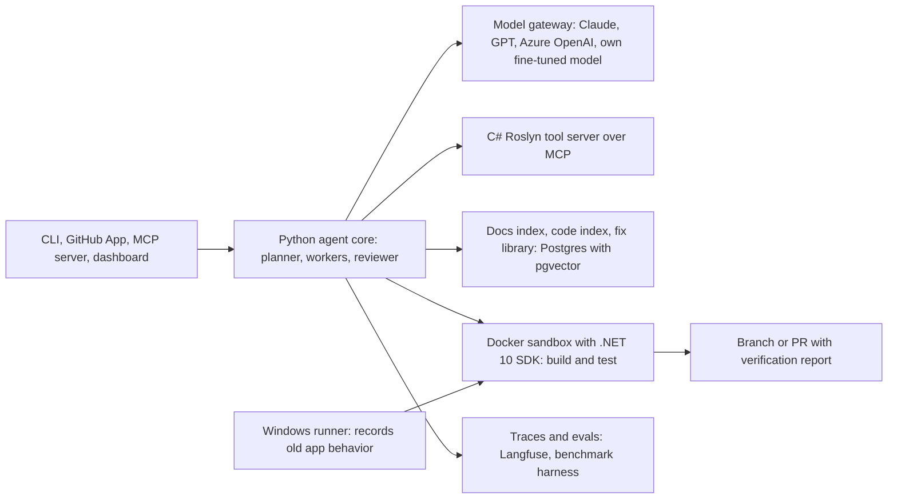

# Ferry: an AI agent that migrates .NET Framework apps to .NET 10

Ferry is a working name.

## What you're building

- An open-source agent that runs on your own machine and migrates a .NET Framework solution to .NET 10 (the current long-term support release, supported until November 2028). It then checks the result: it builds, the tests pass, and no tests were deleted or skipped. You get back a branch or pull request with a report.
- It works with any model: Claude, GPT, Azure OpenAI, or your own fine-tuned model. Code only leaves the machine if the user picks a cloud model.
- Ways to use it: a CLI, an MCP server (so Cursor, Claude Code or VS Code can call it), a GitHub App, and a small dashboard.
- Positioning: Microsoft's Copilot modernization and AWS Transform already do this inside their own ecosystems. Your edge is being open and model-agnostic, checking that behavior is unchanged (not just that it compiles), and publishing reproducible benchmark scores with cost per repo. Expect open-source users and a strong CV piece, not big revenue.

## Why this product teaches nearly every AI concept

- A migration's success can be checked automatically (it builds, tests pass, behavior matches). That gives you clean evals, honest metrics, and real training data, which most portfolio projects don't have.
- [Poly-MigrationBench-dotnet](https://github.com/amazon-science/Poly-MigrationBench) from Amazon Science provides 100 real .NET Framework repos. Each comes with a starting commit whose tests pass and a check command (`dotnet test <solution>`). Your CV claim becomes something anyone can verify: "scores X% on Amazon's benchmark."
- You've already migrated ASP.NET 4.8 MVC and 4.6 Web API apps to .NET 8 by hand, so you can judge output quality like a domain expert. You'll need that when you build LLM judges.

## Architecture

- **Python** holds the agent core, model gateway, retrieval, evals and fine-tuning. This also fills the Python gap on your CV.
- **C#** holds a Roslyn tool server built with the official MCP C# SDK. It handles project analysis, converting project files to the modern format, symbol search, code rewrites and compiler diagnostics.
- **Supporting pieces:** Postgres with pgvector for search indexes and run history, a Docker sandbox with the .NET 10 SDK, and Langfuse for traces.
- **Proposed folders in this repo:** `agent/`, `roslyn-tools/`, `recipes/`, `katas/`, `evals/`, `sandbox/`, `app/`, `training/`, and `docs/DECISIONS.md`.

## Build roadmap

Each phase adds a product feature plus the AI concepts behind it. That's about 20 weeks at 20+ hours a week. Ship a public v0.1 at week 6 and start applying for jobs around week 10.

### Phase 0 (week 1): Foundations

- **Build:** a Python project (managed with uv), a model gateway over two providers, and the Roslyn tool server over MCP. Then `ferry assess`: it lists projects, target frameworks, packages, and Windows-only or System.Web APIs, and the LLM turns that into a structured report.
- **Learn:** tokens, context windows, sampling, pricing, streaming, structured outputs, prompt basics, and MCP on both the server and client side.
- **Done when:** `ferry assess` produces a schema-checked report for 5 benchmark repos and prints its token cost.

### Phase 1 (weeks 2-3): Evals first, plus a non-AI baseline

- **Build:** a harness that checks out a benchmark repo at its starting commit, runs a migration in the sandbox, then runs that repo's check command.
- **Data split:** a 20-repo dev set you tune on, and a separate hold-out set you never tune on.
- **Katas:** 10-15 tiny projects, each isolating one problem: packages.config, the old project-file format, ConfigurationManager, BinaryFormatter (removed in .NET 9), System.Web, and WCF clients.
- **Non-AI baseline:** a scripted first pass (convert project files to the modern SDK style, retarget to net10.0, bump package versions) shows how far you get without any AI.
- **Learn:** building with evals from day one, golden datasets, dev versus hold-out sets, choosing metrics, and sandboxing. You'll also meet reward hacking: agents will delete or skip failing tests to "pass," so the checker compares test counts before and after.
- **Done when:** you have a scoreboard for the non-AI baseline on the dev set.

### Phase 2 (weeks 3-5): The agent loop

- **Build:** a hand-written loop with tools to read, search, edit, build and test. It edits, builds, reads the compiler errors, and fixes until the build is green or the budget runs out. It saves checkpoints so runs can resume.
- **Then compare:** rebuild the loop on one agent framework (LangGraph, OpenAI Agents SDK, or Claude Agent SDK) and record the trade-offs in `docs/DECISIONS.md`.
- **Learn:** tool calling, designing tools for agents, the ReAct pattern, self-correction against a checker (here, the compiler), budgets and stop conditions, saving state, and framework trade-offs.
- **Done when:** the agent beats the non-AI baseline, with a chart of build errors per iteration.

### Phase 3 (weeks 5-6): Retrieval (RAG), then ship v0.1

- **Build a docs index:** Microsoft's porting guides, the .NET 5-10 breaking-change lists, and package changelogs.
- **Build a code index:** one chunk per symbol, plus the graph of which code references which (from Roslyn).
- **Search:** combine keyword search (BM25) with embeddings using reciprocal rank fusion, then rerank the results.
- **Ship v0.1:** a public CLI where users bring their own API key, and a README with benchmark scores.
- **Learn:** chunking, embeddings, vector databases, hybrid search, reranking, graph-based retrieval, and measuring retrieval quality (recall@k).
- **Done when:** recall@5 is measured, and you've compared success rate and cost with and without RAG.

### Phase 4 (weeks 7-8): Context engineering and memory

- **Build:**
  - a token budget for each model call
  - summarizing long conversation histories so they fit
  - prompt caching for the parts of the prompt that never change
  - a per-repo memory of decisions (for example, "keep Entity Framework 6 for now")
  - a fix library: every verified error-and-fix pair, pulled in as examples on future runs
- **Learn:** context engineering, types of agent memory, the economics of caching, choosing examples dynamically, and versioning prompts.
- **Done when:** cost per successful repo drops measurably, with equal or better success.

### Phase 5 (weeks 9-11): Planning, multiple agents, your approval, and the Web API recipe

- **Planner:** orders the work bottom-up through project references and makes strategy calls, such as keeping Entity Framework 6 or targeting both old and new frameworks in libraries. You approve the plan before anything runs.
- **Workers and reviewer:** parallel worker agents migrate independent projects, and a reviewer agent critiques each diff.
- **Crash recovery:** runs survive crashes using Temporal, or a simple state machine stored in Postgres.
- **Web API recipe:** add ASP.NET Web API 2 to ASP.NET Core. To check it, record real requests and responses from the old app on a free GitHub Actions Windows machine, then replay them against the new app.
- **Learn:** orchestrator-worker and reviewer patterns, planning and replanning, human-in-the-loop approval, long-running workflows, comparing old and new behavior, and having the LLM write tests that capture current behavior (they must pass on the old code first).
- **Done when:** Web API projects pass the replay check. Use ones from the benchmark (such as WebAPIDoodle) plus your katas.

### Phase 6 (weeks 12-13): Evals that hold up to scrutiny

- **LLM judge:** grades code quality and whether each test's original purpose survived. Calibrate it against your own grades on about 100 diffs.
- **Repeat runs:** report pass@k with confidence intervals, and group similar failures to find the common causes.
- **CI:**
  - a quick smoke set runs on every change
  - the dev set runs nightly
  - the hold-out set runs monthly
- **Public leaderboard:** compares models. Optionally include Copilot modernization, run by hand, as a baseline.
- **Learn:** designing and calibrating judges (agreement scores), statistics for systems that give different answers each run, error analysis, regression gates, and embeddings with clustering.
- **Done when:** no prompt or agent change ships without passing the eval gate.

### Phase 7 (weeks 14-15): Safety and running it in production

- **Safety:**
  - limit the sandbox's network access to NuGet only
  - scan `web.config` and `app.config` for secrets and strip them before anything reaches a model
  - add red-team katas whose code comments try to hijack the agent (prompt injection)
  - restrict permissions: the agent writes only inside the repo and never pushes to the default branch
- **Operations:**
  - send OpenTelemetry traces to Langfuse (cost, p50/p95 latency, tool calls)
  - start each task on a cheap model and escalate on failure, using a small gradient-boosting classifier to predict difficulty
  - fall back to another provider when one fails
  - use batch APIs for benchmark runs
- **Learn:** the OWASP Top 10 for LLM apps, prompt injection, least privilege, preventing data leaks, observability, cost optimization, and classical machine learning.
- **Done when:** the red-team suite passes and routing cuts cost without lowering success.

### Phase 8 (weeks 16-18): Fine-tune and serve your own model

- **Dataset:** verified fixes (an error plus its context, paired with the fix that was accepted). Split by repo so test repos never leak into training.
- **Fine-tune:** a 7B-class open code model with LoRA/QLoRA (using Unsloth or Hugging Face TRL) on a rented GPU.
- **Serve:** run it compressed (quantized) with vLLM, and route the easy fix steps to it.
- **Stretch:** DPO, which trains on accepted versus rejected fixes, and reinforcement learning (GRPO) with "the build passes" as the reward.
- **Learn:** post-training, distillation from a bigger model, LoRA/QLoRA, quantization, serving and throughput, preference optimization, and reinforcement learning with automatically checkable rewards.
- **Done when:** your model handles a measurable share of fix steps for a fraction of the cost, with no drop in hold-out success.

### Phase 9 (weeks 19-20): Product polish and launch

- **GitHub App:** comment `/ferry migrate` to get a pull request with the report. It also responds to review comments.
- **IDE and dashboard:** the MCP server for IDEs, and a FastAPI plus HTMX dashboard that streams the agent's steps live and lets you approve plans.
- **Optional MVC 5 recipe:** checked by screenshotting old and new pages and having a vision model judge the differences.
- **Launch:**
  - write-ups on the benchmark results, failure analysis, and the fine-tuning cost story
  - posts on r/dotnet, in .NET newsletters, and as a Show HN
  - free migration pull requests to open-source repos still on .NET Framework
- **Learn:** product design for AI tools (streaming, approvals, earning trust), evaluating with vision models, and distribution.

## Reading list

- Foundations: Chip Huyen, *AI Engineering*.
- Agents: Anthropic, "Building effective agents" and "Effective context engineering for AI agents."
- Designing tools for agents: the SWE-agent paper.
- Retrieval: Anthropic, "Contextual Retrieval."
- Evals: Hamel Husain's posts on evals and LLM-as-judge.
- Migration-specific: the [MigrationBench paper](https://arxiv.org/abs/2505.09569), Google's [Migrating Code At Scale With LLMs](https://arxiv.org/abs/2504.09691), and Airbnb's [Enzyme migration with LLMs](https://airbnb.tech/infrastructure/accelerating-large-scale-test-migration-with-llms/).
- Safety: the OWASP Top 10 for LLM Applications.
- Fine-tuning: the Hugging Face TRL and Unsloth docs.

## What this doesn't cover

Voice, image generation, and training models from scratch. Vision appears only in the optional MVC recipe. AI-engineer job posts rarely ask for these.

## Practical notes

- **Windows:** old .NET Framework apps only run on Windows. Use free GitHub Actions Windows machines (on a public repo) to record how the old app behaves. Everything else runs in Linux containers on your Mac.
- **Costs:** set a monthly API budget, develop on a cheap model, and use batch APIs for benchmark runs. Renting a GPU for fine-tuning typically costs tens of dollars.
- **Your job:** never use client code from Enosis, and check your contract's side-project and IP clauses before publishing.
- **If your friend joins:** he owns the platform (GitHub App, sandboxes, Windows runner, dashboard). You keep the agent, retrieval, evals and training, so you still work hands-on with every AI concept.

## What goes on your CV

- "Built Ferry, an open-source AI agent (Python, C#/Roslyn, MCP) that migrates .NET Framework solutions to .NET 10. Scores X% on Amazon's Poly-MigrationBench-dotnet at $Y per repo, with every change gated by evals."
- "Fine-tuned a 7B open model with LoRA on verified build-fix data. It handles Z% of fix steps at a tenth of the cost, with no drop in hold-out success."