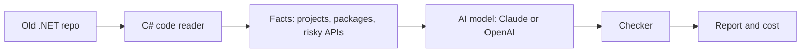

# Phase 0: build `ferry assess` (week 1, about 25 hours)

## What you'll have at the end

One command:

```bash
ferry assess path/to/old-dotnet-repo
```

It reads an old .NET Framework project and gives you a short report:

- which projects it contains, and the .NET version of each
- what will break when you move to .NET 10 (for example `System.Web` or `BinaryFormatter`), with file and line
- how big the job is: S, M, L or XL
- how many tokens the AI used and what that cost

## How it works



1. A **C# code reader** collects facts about the repo. No AI here.
2. **Python** sends those facts to an AI model and asks for the report in a fixed format.
3. A **checker** confirms the answer has the right format and only mentions files and projects that really exist. If the AI made something up, the checker shows the AI its mistakes and asks once more.

## Words you'll meet

- **Token:** a small chunk of text, roughly 3-4 characters. AI models count and charge by tokens.
- **Structured output:** asking the AI to answer in a fixed JSON shape instead of free text, so your code can read it.
- **MCP:** a standard way for an AI program to call tools. Here, Python calls your C# reader through MCP.
- **Temperature:** controls how random the AI's answers are. 0 is the most predictable.

## Before you start (about 30 minutes)

- Install the tools: `brew install uv dotnet`, then `uv python install 3.13`.
- Check that `dotnet --list-sdks` shows 10.0.
- Get API keys from Anthropic and OpenAI, and set a spending limit of about $10 on each.
- Create a GitHub repo for this folder. Public is fine.

## The 8 steps

### 1. Create the folders (2 hours)

- Make these:
  - `agent/` for Python
  - `roslyn-tools/` for C#
  - `docs/`
  - a settings file, `ferry.toml`, for model names and prices
  - a GitHub Actions file that runs the tests
- **It works when:** both projects build, and one empty test passes in each.
- **Who writes it:** an AI helper (Composer 2.5).

### 2. Write the C# code reader (5 hours)

- A small C# program that scans a repo and prints a JSON list of:
  - projects and their .NET versions
  - their packages
  - risky old APIs, with file and line
- Keep the list of risky APIs in one file, `api-risks.json`: `System.Web`, WCF, `BinaryFormatter`, `AppDomain`, the Windows registry, WPF, WinForms, and so on.
- **It works when:** `inventory <repo>` prints correct facts for a few small test projects.
- **Who writes it:** an AI helper (Sonnet 5.5) writes the file reading. You write the risky-API list, because you know these from your own migrations.

### 3. Make the reader an MCP tool (2 hours)

- Wrap the reader so other programs can call it through MCP.
- **It works when:** you open it in MCP Inspector (a free test app), call the tool by hand, and see the facts.
- **Who writes it:** you.

### 4. Call the C# tool from Python (2 hours)

- Create the Python project, and write code that starts the C# tool and asks it for the facts.
- **It works when:** a Python script prints the facts for a repo.
- **Who writes it:** you.

### 5. Talk to the AI models (5 hours)

- Write one small piece of code that calls Claude or OpenAI the same way, and asks for structured output.
- It also saves every call to a log file: tokens used, time taken, and cost.
- **It works when:** the same test question gets a valid answer from both providers, with the cost printed.
- **Who writes it:** you. This is the main AI lesson of the week.

### 6. Build `ferry assess` (5 hours)

- Connect the pieces in this order:
  1. get the facts
  2. shorten them so they fit within the AI's input limit
  3. ask for the report
  4. check it
  5. save it as JSON plus a readable Markdown file
- Write tests that use a fake AI model, so they're free and always give the same result.
- **It works when:** `ferry assess <repo>` saves a report that passes the checker and prints the cost.
- **Who writes it:** you. Ask Opus 5.5 to review your prompt and report format.

### 7. Try it on 5 real repos (2 hours)

- Download the 5 old .NET projects listed at the bottom, from Amazon's public benchmark, and run `ferry assess` on each one with both models.
- **It works when:** you get one table with a row per repo, showing whether the report passed the checks, the tokens used, and the cost.
- **Who writes it:** an AI helper writes the download script. You run it and read the results.

### 8. Learn from small experiments (3 hours)

Write 2-3 lines about each of these in `docs/learning-log.md`:

1. **Tokens:** count the same file with both models. Why do the numbers differ?
2. **Randomness:** run one report 5 times at temperature 0 and 5 times at temperature 1. What changes?
3. **Made-up answers:** turn the checker off. How often does the AI invent file references?
4. **Speed:** how long until the first word arrives, compared with the full answer?
5. **Cost:** which model is cheaper per repo, and is its report still good?
6. **MCP:** what do the raw messages look like in MCP Inspector?

Then write your main choices, and why you made them, in `docs/DECISIONS.md`.

## Phase 0 is done when

- `ferry assess` works on all 5 repos with both models.
- Every report passes the checker.
- Every run prints its token count and cost.
- Tests pass on GitHub without calling paid AI services.

Expected total AI spend is under $10.

## Three mistakes to avoid

- **Logs on normal output:** the C# tool must not print logs there, because MCP uses it for messages. Send logs to stderr.
- **Using `dotnet run`:** start the C# tool from its built file instead, because build messages break MCP.
- **Real AI in tests:** never call the real AI in automated tests. Use the fake model.

## Reference: details for when you build

**The 5 repos** (repo, then the commit to check out). They come from [Poly-MigrationBench](https://github.com/amazon-science/Poly-MigrationBench).

- `kiennq/csclip` at `ddf3ec744cb54c7a0978ce9cd4969af381aa7463`: tiny console app
- `thomaslevesque/NString` at `3eb0b9ed17833d25722d1d0308a7c6e61b85a4a0`: library
- `aspnet/AspNetOutputCache` at `2d81c8ad418343abd1331b5a6da809aa6c66542a`: heavy System.Web use
- `okta/okta-aspnet` at `aa064e81e88979dbf73998fee431fae532571545`: several projects
- `GuOrg/Gu.Wpf.ValidationScope` at `7a90141fb44205add8da38fc8a7d2eb80ea0d1c3`: WPF, Windows only

**Models:**

- Claude Sonnet 5.5: $2 per million input tokens, $10 per million output tokens.
- One low-cost OpenAI model: copy its name and price from OpenAI's pricing page.

**Docs:**

- [MCP C# SDK](https://csharp.sdk.modelcontextprotocol.io/v2/concepts/getting-started.html)
- [MCP Python SDK](https://py.sdk.modelcontextprotocol.io/v2/client/)
- [Anthropic structured outputs](https://platform.claude.com/docs/en/build-with-claude/structured-outputs)
- [OpenAI structured outputs](https://developers.openai.com/api/docs/guides/structured-outputs)
